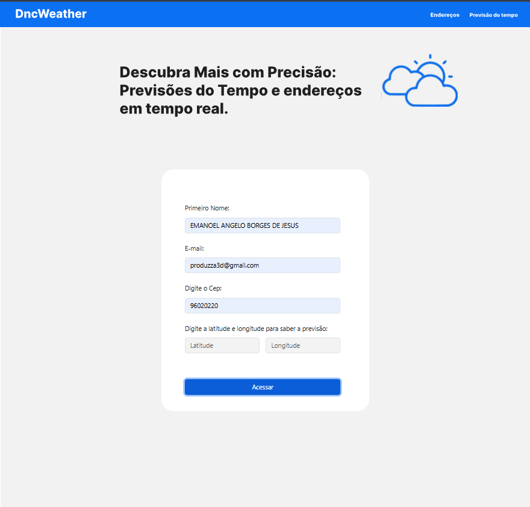
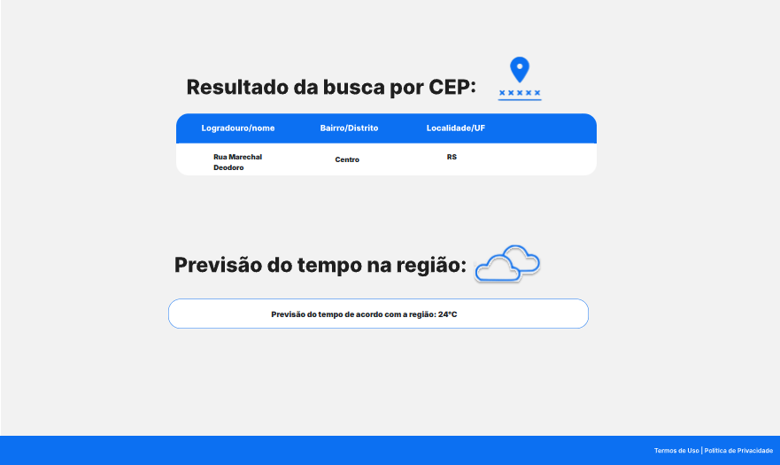

# DncWeather — Desafio 2 DNC

Desenvolvi o DncWeather como parte do segundo desafio da Escola DNC. A proposta foi implementar uma interface a partir de um protótipo do Figma e consumir APIs para apresentar informações de endereço e temperatura em uma única página.

Neste projeto, avancei no uso de JavaScript para realizar requisições assíncronas, interpretar respostas em JSON e atualizar o conteúdo da interface com os dados retornados.

**Versão disponível: somente para computador (desktop).** Desenvolvi o layout para visualização em computadores; o projeto não possui versão adaptada para celulares ou tablets.

**[Acesse a demonstração online pelo computador](https://desafio-2-dnd.netlify.app/)**

## O desafio

Meu objetivo foi transformar o layout de referência em uma página funcional, reunindo dois tipos de consulta: endereço por CEP e temperatura por latitude e longitude. Para isso, combinei a estrutura em HTML, a estilização com CSS e Bootstrap e a lógica de integração com serviços externos.

## Conheça o projeto

### 1. Apresentação e entrada de dados

Organizei a página com a identidade DncWeather, uma apresentação da proposta e um formulário central. A interface inclui campos de primeiro nome, e-mail, CEP, latitude e longitude, além do botão “Acessar”.

Na implementação atual, utilizo o CEP e as coordenadas para realizar as consultas. Os campos de nome e e-mail compõem a interface do exercício e não são utilizados nas requisições às APIs.



### 2. Endereço e temperatura

Ao clicar em “Acessar”, executo uma função assíncrona que consulta primeiro o ViaCEP. Com a resposta, atualizo os campos de logradouro, bairro e UF na área de resultados. Embora o cabeçalho visual indique “Localidade/UF”, o código atual exibe somente a sigla do estado nessa coluna.

Em seguida, consulto o Open-Meteo com a latitude e a longitude informadas e apresento a temperatura atual retornada pelo serviço, em graus Celsius.



**Sobre a captura:** a página possui valores de exemplo antes das consultas, incluindo a temperatura de 24 °C. Por isso, o valor exibido na imagem, isoladamente, não confirma uma resposta do Open-Meteo. A consulta de temperatura utiliza as coordenadas preenchidas pelo usuário; o código não obtém essas coordenadas automaticamente a partir do CEP.

## Como implementei as consultas

| Etapa | O que fiz |
| --- | --- |
| Leitura dos campos | Capturei CEP, latitude e longitude pelos identificadores dos elementos no HTML. |
| Consulta de endereço | Utilizei `fetch` para requisitar o endereço ao ViaCEP e converti a resposta com `response.json()`. |
| Exibição do endereço | Atribuí os valores de `logradouro`, `bairro` e `uf` aos elementos da página usando `textContent`. |
| Consulta de temperatura | Requisitei ao Open-Meteo a variável `current.temperature_2m` para as coordenadas informadas. |
| Exibição da temperatura | Atualizei o resultado na interface, acrescentando a unidade °C. |
| Tratamento de exceções | Utilizei `try/catch` para registrar erros no console do navegador. |

As requisições são sequenciais e dependem de conexão com a internet e da disponibilidade das APIs.

## Tecnologias que utilizei

| Tecnologia | Aplicação no projeto |
| --- | --- |
| HTML5 | Estrutura da página, campos de entrada e áreas de resultado. |
| CSS3 | Cores, espaçamentos e posicionamento dos elementos. |
| Bootstrap 5.3.3 | Componentes, classes de formulário e organização do layout. |
| JavaScript | Leitura dos campos, requisições com `fetch`, `async/await` e manipulação do DOM. |
| ViaCEP | Consulta de endereço a partir do CEP. |
| Open-Meteo | Consulta da temperatura atual por latitude e longitude. |
| Google Fonts | Tipografia Inter. |
| Netlify | Publicação da demonstração. |

## O que aprendi

Com este desafio, pratiquei o consumo de duas APIs na mesma aplicação e o uso de funções assíncronas. Trabalhei a leitura de objetos JSON, a atualização de elementos do DOM e a conexão entre os dados informados no formulário e os resultados apresentados na tela.

Também exercitei a implementação de uma interface a partir de uma referência visual e o uso de Bootstrap junto a estilos próprios.

## Como executar e utilizar

1. Clone o repositório:

   ```bash
   git clone https://github.com/EmanoelAngelo/Desafio-2-DNC.git
   ```

2. Abra a pasta `Desafio-2-DNC`.
3. Abra o arquivo `index.html` no navegador ou utilize a extensão Live Server do VS Code.
4. Preencha um CEP válido e as coordenadas desejadas.
5. Clique em **Acessar** e consulte as áreas de resultado abaixo do formulário.

Não é necessário instalar dependências nem executar uma compilação. As bibliotecas carregadas por CDN e as consultas às APIs exigem conexão com a internet.

## Organização dos arquivos

| Arquivo ou pasta | Conteúdo |
| --- | --- |
| `index.html` | Estrutura da página, estilos locais e lógica JavaScript das consultas. |
| `img/` | Recursos visuais em SVG utilizados na interface. |
| `docs/images/` | Capturas de tela utilizadas neste README. |

## Contexto e possibilidades de evolução

Este é um projeto de estudo desenvolvido a partir de uma atividade da Escola DNC. As capturas apresentam a interface em computador.

Na versão atual, as falhas são registradas no console, sem mensagem de erro na interface. Como evolução, posso adicionar validação de CEP e coordenadas, indicadores de carregamento e mensagens para consultas inválidas. Também posso ajustar o tratamento da temperatura de 0 °C, que atualmente é interpretada como ausência de valor pela condição utilizada no código, e aprimorar a adaptação do layout para diferentes tamanhos de tela.

## Referência visual

Implementei a interface com base no [protótipo do desafio no Figma](https://www.figma.com/file/cPLXzs1LNGDRDluE5pr1z4/Desafio-02%3A-Desafio%3A-Desenvolva-tela-funcional-com-consumo-de-API%C2%B4s?type=design&node-id=0-1&mode=design&t=M926U2KmEZ7EIzCR-0).

---

Desenvolvido por **[Emanoel Angelo](https://github.com/EmanoelAngelo)** durante meus estudos na **Escola DNC**.
